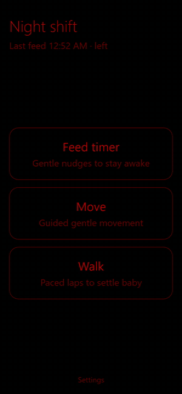
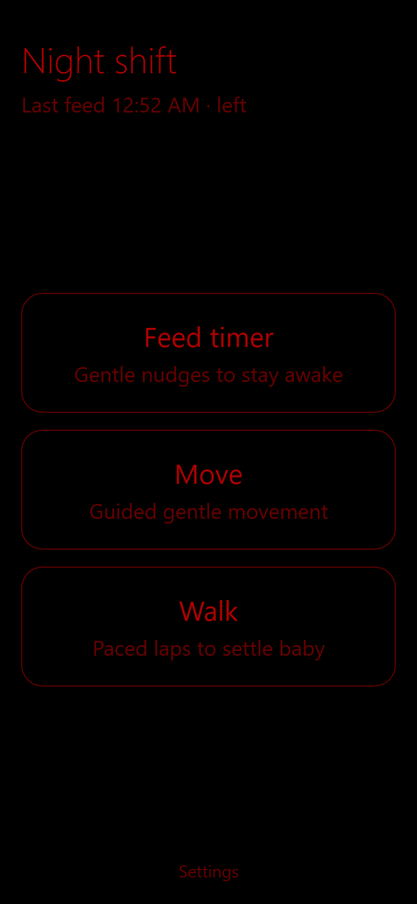
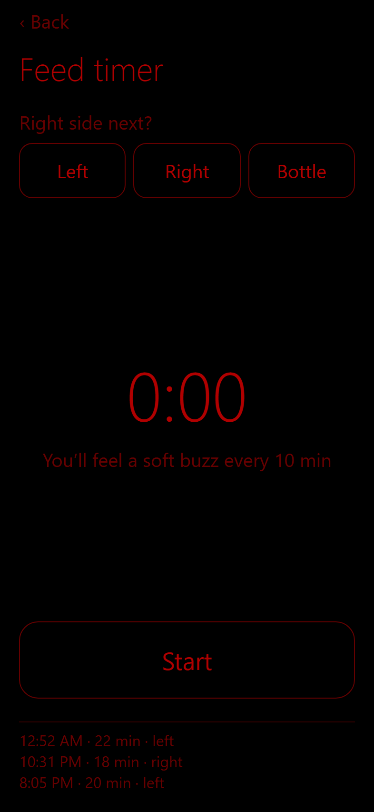
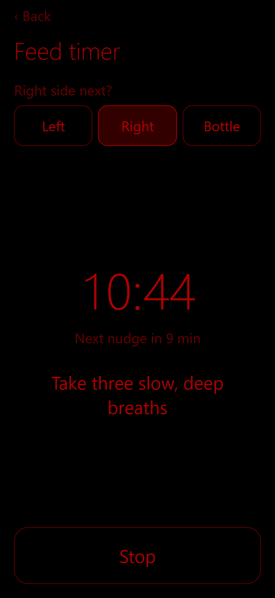
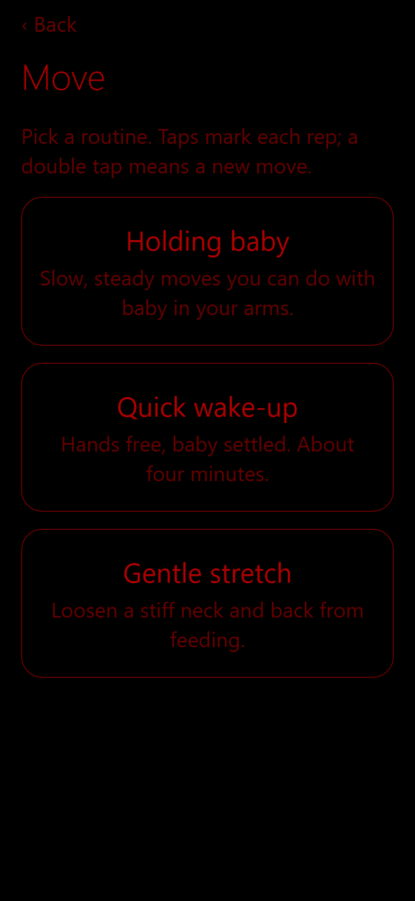
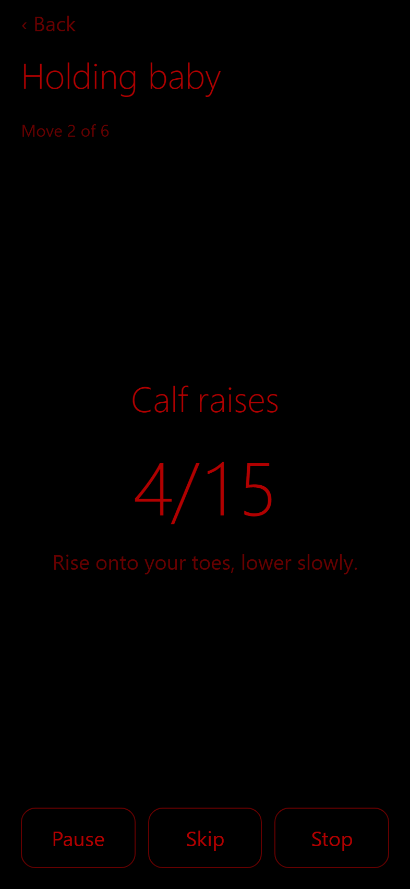
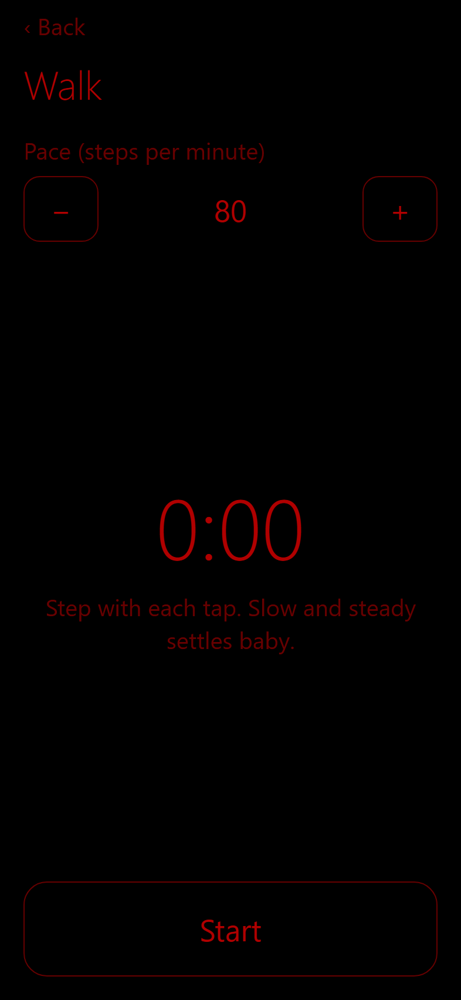
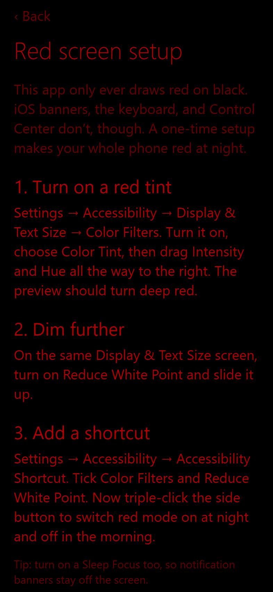

# NightWorkout

An iPhone app for parents up at night with a newborn. It only uses red on black, and does three things: a feed timer that buzzes you every few minutes so you don't fall asleep, short guided movement routines, and a walking metronome for settling laps.

**▶ Try it:** install **Expo Go** on your iPhone, start the app on your computer and scan the QR code ([steps below](#run-it-locally)). You don't need a Mac.

<p align="center">
  
</p>
<p align="center"><sub><a href="docs/media/demo.mp4">Full-quality video (MP4)</a>. The feed timer is fast-forwarded to the first nudge.</sub></p>

## The problem

A phone screen at 3 am is bright enough to wake you up properly, and sometimes the baby too. Dark mode and Night Shift still use white text. It's also easy to nod off during a long feed, and after hours of sitting and rocking you get stiff, but workout apps expect you to watch the screen.

## The solution

Everything in the app is red on black, and it uses vibration so you mostly don't need to look at it.

| Feature | What it does |
|---|---|
| **Red only** | Every colour is pure red (`#RR0000`) or black, so on OLED iPhones (X and later, all 12+) only the red subpixels light up. The screen is dimmed to 10% (adjustable) while the app is open, and your brightness comes back when you leave. |
| **Feed timer** | Pick left, right or bottle; it suggests the other side from last time. Every 10 minutes (5–30, adjustable) you get a soft buzz and a small prompt like *"Roll your shoulders 5 times"*. Recent feeds are listed with time, length and side. |
| **Move** | Three short routines: **Holding baby** (things you can do with the baby in your arms), **Quick wake-up** and **Gentle stretch**. One tap per rep, two taps for a new move, so you can follow along without looking. Pause, skip or stop at any time. |
| **Walk** | Taps at a set pace (50–110 steps per minute) to walk to, and counts your steps with the iPhone's motion sensor. |
| **No system pop-ups** | Native alerts, pickers and the keyboard can't be made red, so the app doesn't use them. |
| **Red screen setup** | A guide (shown on first launch and in Settings) for turning on iOS Color Filters, Reduce White Point and the Accessibility Shortcut, so notifications and Control Center are red too. |

Settings and sessions are stored on the phone. There's no account and no server.

## Screenshots

<table>
  <tr>
    <td align="center"><br><sub>Home</sub></td>
    <td align="center"><br><sub>Feed timer</sub></td>
    <td align="center"><br><sub>A nudge during a feed</sub></td>
    <td align="center"><br><sub>Routines</sub></td>
  </tr>
  <tr>
    <td align="center"><br><sub>During a routine</sub></td>
    <td align="center"><br><sub>Walk</sub></td>
    <td align="center"><br><sub>Red screen setup</sub></td>
    <td></td>
  </tr>
</table>

<sub>Taken from the web build in a phone-sized browser. On a phone the screen is dimmed as well.</sub>

## Tech stack

| Area | Choice |
|---|---|
| Framework | [Expo](https://expo.dev) SDK 58 · React Native 0.88 · React 19.3 (with the React Compiler) |
| Language | [TypeScript](https://www.typescriptlang.org/) 6 |
| Navigation | [Expo Router](https://docs.expo.dev/router/introduction/) (file-based routes in `src/app/`) |
| Haptics | `expo-haptics`, with named patterns for a tap, double tap, nudge and finish |
| Screen | `expo-brightness` to dim while open, `expo-keep-awake` so the screen stays on during timers |
| Step counting | `expo-sensors` Pedometer |
| Storage | `@react-native-async-storage/async-storage` |
| Colour check | `scripts/check-palette.mjs` fails if a non-red colour appears in `src/` or `app.json` |
| Lint | ESLint 9 with `eslint-config-expo` |
| README media | [Playwright](https://playwright.dev/) and [ffmpeg-static](https://github.com/eugeneware/ffmpeg-static) (`npm run media`) |

## Red-light rules

- Every colour lives in `src/theme/palette.ts` and is pure red (`#RR0000`) or black.
- `npm test` fails if any other colour literal appears in `src/` or `app.json`.
- No native alerts, pickers or keyboard. They render in system colours.
- The setup guide (`/setup`) covers the parts of iOS the app can't colour itself.

## Run it locally

### Prerequisites

- **[Node.js](https://nodejs.org/) LTS** (includes npm).
- **[Git](https://git-scm.com/)** to download the code.
- **Expo Go** on your iPhone (App Store).
- The computer and the phone on the same Wi-Fi network.

Everything below works from Windows.

### 1. Download

```bash
git clone https://github.com/MasonHolland/NightWorkout.git
cd NightWorkout
```

Without Git, download the ZIP from the [repository page](https://github.com/MasonHolland/NightWorkout) (**Code → Download ZIP**), unzip it, and open a terminal in that folder.

### 2. Install dependencies

```bash
npm install
```

### 3. Start the app

```bash
npx expo start
```

Scan the QR code in the terminal with the iPhone Camera app and it opens in Expo Go. Haptics, dimming and step counting only work on a real phone. If the phone can't connect, use `npx expo start --tunnel`.

### Other commands

| Command | What it does |
|---|---|
| `npm test` | Red-light palette check |
| `npm run typecheck` | Check TypeScript types |
| `npx expo lint` | Run ESLint |
| `npm run icons` | Regenerate the red moon icons |
| `npm run web` | Run in a browser, for layout checks only (no haptics, dimming or step counting) |
| `npm run media` | Re-record the screenshots and demo video in `docs/media/` (see below) |

## Release

```bash
npx eas-cli@latest build -p ios      # needs an Apple Developer account
npx eas-cli@latest submit -p ios     # upload to TestFlight / App Store
```

## Screenshots and demo video

`npm run media` records everything in `docs/media/` with Playwright, using the web build in a phone-sized Chromium. It starts `expo start --web` on port 8082 if it isn't already running, and writes PNG screenshots, `demo.mp4`, `demo.gif` (used above) and `demo-poster.jpg`. Use `npm run media -- --only shots` or `--only video` to do half. The first time, run `npx playwright install chromium`.

The browser clock is set to 2:41 am with a few earlier feeds already logged, and the timers are fast-forwarded where waiting would take minutes. The steps are in `scripts/media/capture.mjs`.

## Project structure

```
src/
  app/                 Screens (Expo Router: every file is a route)
    _layout.tsx        Root stack, red navigation theme, screen dimming
    index.tsx          Home: last feed and the three activities
    timer.tsx          Feed timer with stay-awake nudges
    move.tsx           Guided routines (rest → move → reps)
    walk.tsx           Walking metronome and step count
    settings.tsx       Brightness, nudge interval, vibration strength
    setup.tsx          Red screen setup guide (first launch)
  components/ui.tsx    Red-only building blocks: Screen, BigButton, Stepper, Segmented …
  data/routines.ts     Routines and the quick stay-awake moves
  hooks/               Night brightness and keep-awake
  lib/                 Haptic patterns, settings, session storage, formatting
  theme/palette.ts     The only place colours are defined
scripts/               Palette check and icon generator; media/ records the README screenshots and video
docs/media/            Screenshots and demo video used in this README
```

## Good to know

- **Do the red screen setup.** The app can only colour itself. iOS banners, the keyboard and Control Center stay white until the Color Filter is on (Settings → Red screen setup guide). A Sleep Focus keeps banners off the screen.
- Pulling down Control Center doesn't restore your normal brightness, so the screen won't flash bright. Leaving the app does.
- Feeds, walks and routines are only stored on the phone.
